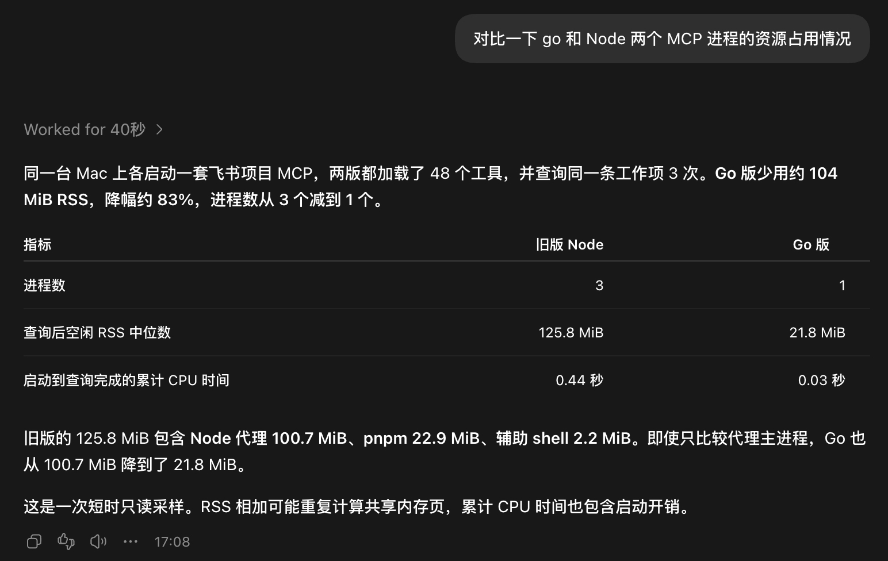

# meego-mcp-go

## 项目介绍

`meego-mcp-go` 是飞书项目（Meego）的 Go 版 MCP 代理。它让 Codex 通过本地 stdio 查询工作项、评论和项目空间，也可以调用飞书项目为当前账号开放的写入工具。项目是独立实现，权限由飞书项目及用户 Token 决定。

Go 版以单个可执行文件运行，安装后无需 Go、Node.js 或 pnpm。它直接从本机 Codex 配置读取凭证，并保留远端工具定义、参数和结果中的 JSON 字段。

### 资源占用对比

## 安装

[安装教程](INSTALL.md) 提供下载、校验、Codex 与 Token 配置、只读验证和迁移步骤。 [下载 v1.0.0](https://github.com/yjcdon/meego-mcp-go/releases/tag/v1.0.0)
